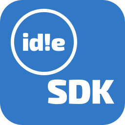

<p align="center">
  
</p>

<h1 align="center">oss!idle Addon SDK</h1>

<p align="center">
  Build <a href="https://github.com/oss-idle/oss-idle">oss!idle</a> add-ons in TypeScript, with your dependencies bundled.
</p>

## Quickstart

```sh
name=my-addon
npx @oss-idle/addon-sdk-create@latest "$name"
cd "$name" && npm install && npm run build
```

This emits one self-contained ES module. Paste it into the in-game add-on editor (Options → Add-ons → Manage) and enable it.

**[Read the SDK documentation](packages/addon-sdk/README.md)**. The runtime contract, overlay rules, reading the game's state, and bundling the game's own simulation.

Or let oss!idle build it: push it to a public git repository, run `npm run setup` for what to fill in when creating a **Built from a git repository** add-on in game, add the webhook it gives you, and release with `npm run release`. See the scaffolded README.

## Building from a repository

oss!idle builds a repository add-on itself, from the newest version tag: `npm ci --ignore-scripts`, then `npm run build` with no network, then it reads `outfile` from `addon.config.json`. So:

- commit `package-lock.json`, never `dist/`;
- nothing may need its install scripts or the network at build time, and no dependency may come from git (an https tarball is fine);
- `gameRoot` has to point inside the repository: the builder has no oss!idle checkout and clones no submodules. Depend on a game release's tarball, pinned by commit (`"oss-idle": "https://codeload.github.com/oss-idle/oss-idle/tar.gz/<commit>"`), and point `gameRoot` at `node_modules/oss-idle`. Whatever the game's sources import that your add-on does not stub has to be your own dependency too;
- `gameVersion` in `addon.config.json` names the game release it targets (default: the current one).

## What's provided

- An **`Addon` base class** that records teardown for every listener, timer and overlay it hands you, because add-ons are enabled, disabled, updated and removed without a page reload.
- **Shadow-root React overlays** that the game's CSS cannot reach and that cannot restyle the game, with input isolation so typing in your overlay never presses gameplay keys.
- **Bridges** to the game's sql.js database, its beatmap store, the character
  actually being played, the player's playlists and their play history.
- A **bundler** that emits the single-file ES module the add-on runtime loads: CSS, workers and WebAssembly all inlined (React too, unless it uses the game's), because a Blob-loaded module resolves nothing at load time.

## Development

```sh
npm install
npm run verify    # build, then the settings and scaffolding suites
```

The scaffolding suite generates both templates, installs them against this working copy, and builds them into real add-ons, so a broken template fails here rather than in someone's first five minutes.

## Releasing

Pushing `master` runs the suite and publishes any workspace whose version is not on npm yet, so a release is a version bump and a push. Pushes that change no version publish nothing.

Publishing uses npm [trusted publishing](https://docs.npmjs.com/trusted-publishers): the workflow authenticates through GitHub's OIDC token, so there is no npm token in the repository's secrets. Each package needs its publisher registered once on npmjs.com - **Settings - Trusted publishers** on the package, naming this repository and `.github/workflows/publish.yml`.

## A reference add-on

[oss!idle sim](https://github.com/oss-idle/addon-sim) is built with this SDK and exercises most of it: a worker pool, an inlined WebAssembly module, the game's own simulation bundled from source, persisted settings, and playlist writes into the client's database.

## Licence

AGPL-3.0-only. The SDK's runtime code is bundled into every add-on built with it, so add-ons inherit this licence.
